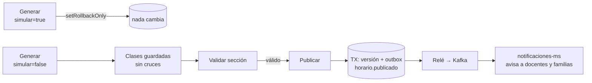
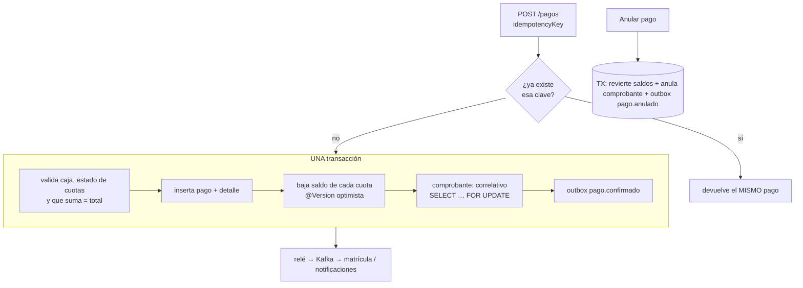

# Un proceso transaccional por integrante

Idea común (clase S9 de Pagatu, *consistencia distribuida*): **cada servicio garantiza su transacción local (ACID)** y la coordinación entre servicios se hace con
**eventos** (patrón **outbox**) y **compensaciones** (saga coreografiada). Nunca hay una transacción global.

Tres piezas que se repiten en los tres procesos:

| Pieza | Qué resuelve | Dónde vive |
|---|---|---|
| **Outbox** | Guardar el dato **y** el evento en la misma transacción; un relé los publica después | `outbox_eventos` (planificación, alumnos, matrícula, pago) |
| **Idempotencia** | Que repetir una orden o un mensaje no lo ejecute dos veces | `idempotency_key`, `eventos_procesados`, restricciones únicas |
| **Compensación** | Deshacer el efecto de un paso ya confirmado cuando algo posterior falla o se cancela | anulación de pago, retiro/anulación de matrícula |

---

## A. Hermes — Publicar un horario «todo o nada» (`planificacion-ms` → `notificaciones-ms`)

**Idea.** Armar y publicar el horario de una sección es un proceso transaccional: o queda todo coherente (clases sin cruces + versión publicada + evento), o no queda nada.



**Pasos y garantías**
1. **Generar (simular)** — el generador resuelve el problema con el mismo código que al guardar y termina con `setRollbackOnly`: la simulación es **la misma transacción, revertida**.
2. **Generar (guardar)** — todas las clases de las secciones elegidas entran en **una transacción**; las restricciones duras (docente, aula, sección) hacen que un horario inválido no exista.
3. **Invariantes en cada alta manual** — un choque se rechaza con 409 y **no deja nada a medias** (`existsChoqueDocente/Aula/Seccion`).
4. **Publicar** — en **una transacción**: comprueba que hay clases y que no hay choques, crea la **versión** y registra el evento `horario.publicado` en el **outbox** (`OutboxRecorder`, `BEFORE_COMMIT`).
5. **Después del commit** — `OutboxRelay` (`AFTER_COMMIT` + programado cada 2 s) envía a Kafka; `notificaciones-ms` consume con **idempotencia** (`eventos_procesados`) y crea los avisos.

**Compensación / recuperación.** No hay «despublicar»: se publica una **nueva versión** (el historial queda). Si Kafka está caído, el evento espera en el outbox.

**Datos de apoyo (medidos).** 12 secciones, 288 clases, 0 cruces, 0,3–0,6 s.

**Demostración en vivo:** `AUTH_MODE=eduspace python3 tools/demo/proceso_hermes.py`
- Muestra «288 antes / 288 después de simular», el 409 del choque y la versión publicada.

**Pruebas que lo respaldan:** `PlanificadorHorarioTest`, `AsignacionPorEspecialidadTest` y las de integración de horarios/publicación (`PlanificacionApiIntegrationTest`).

**Preguntas de defensa**
- ¿Por qué simular con rollback en vez de otro algoritmo? → Garantiza que lo simulado es **exactamente** lo que se guardaría.
- ¿Qué pasa si se publica dos veces? → Cada publicación crea la versión siguiente; los consumidores son idempotentes por `eventId`.
- ¿Y si el servicio cae entre el commit y Kafka? → El evento ya está en `outbox_eventos`; el relé lo envía al volver.

---

## B. Andre — Matrícula con cupo atómico, pago y compensación (`matricula-ms` ↔ `pago-ms` ↔ `alumnos-ms`)

**Idea.** Es una **saga coreografiada**: cada servicio hace su transacción local y reacciona a los eventos de los demás. La matrícula pasa por estados y puede **compensarse**.

```mermaid
sequenceDiagram
  participant M as matricula-ms
  participant K as Kafka
  participant P as pago-ms
  M->>M: TX1: pre-matrícula + cupo (UPDATE … WHERE ocupados < capacidad) + outbox
  M-->>K: matricula.creada
  K-->>P: TX local: crea la cuota de matrícula
  P->>P: TX2: cobro idempotente + comprobante + outbox
  P-->>K: pago.confirmado
  K-->>M: TX3: PRE_MATRICULA → POR_APROBAR (sin evento)
  Note over M: El administrador revisa y aprueba (PATCH /aprobar)
  M->>M: TX4: POR_APROBAR → MATRICULADO + outbox
  M-->>K: matricula.confirmada
  K-->>P: genera las 10 pensiones
  Note over M,P: Compensaciones: vence/retiro/anulación → matricula.anulada|retirada → pago anula cuotas; el cupo se libera
```

**Pasos y garantías**
1. **TX1 (matrícula)** — en **una** transacción: reservar cupo con una sola sentencia atómica (`UPDATE cupos_seccion … WHERE ocupados < capacidad`), insertar la matrícula, requisitos, historial y el evento en el outbox. Si no hay cupo → 409 y **no se escribe nada**. Dos alumnos por la última vacante: uno gana, el otro recibe 409.
2. **Pago** — `pago-ms` reacciona a `matricula.creada` (cuota) y cobra de forma **idempotente**; publica `pago.confirmado`.
3. **TX3** — `matricula-ms` consume `pago.confirmado` (idempotente por `eventId`) y registra el pago: `PRE_MATRICULA → POR_APROBAR` (conserva el cupo y no vence; **no** publica nada todavía).
4. **TX4 · aprobación administrativa** — solo el ADMIN: `POR_APROBAR → MATRICULADO` + `matricula.confirmada` en el outbox (idempotente: aprobar dos veces no publica dos eventos). Si la rechaza: `ANULADO`, cupo liberado, `matricula.anulada`. Para matrículas en línea, después de aprobar se crean las cuentas y se envía el correo con el acceso.
5. **Efectos aguas abajo** — pago genera las pensiones; asistencia, tareas, exámenes y calificaciones crean su réplica `matriculas_local`; notificaciones avisa.

**Compensaciones**
| Disparador | Compensación |
|---|---|
| La pre-matrícula **vence** sin pago (`VencimientoJob`, con ShedLock) | `ANULADO`, **libera el cupo**, evento `matricula.anulada` → pago anula cuotas |
| Secretaría **anula** o el alumno se **retira** | Igual: cupo liberado, cuotas pendientes anuladas, parciales a alerta administrativa |
| Fallo del pago (rechazo) | No hay efecto: la reserva se mantiene hasta vencer (vigencia configurable) |
| Cuota no se generó en la matrícula en línea | La matrícula se anula en el acto (compensación inmediata) |

**Demostración en vivo:** `AUTH_MODE=eduspace python3 tools/demo/proceso_andre.py`
- Muestra los cupos antes/durante/después, el 402 del rechazo, el pago repetido con el mismo comprobante y el cupo que vuelve tras el retiro.

**Pruebas que lo respaldan:** «último cupo con 2 hilos», «traslado a sección llena», «pago repetido», «vencimiento», «outbox con Kafka caído» (matricula-ms, 25 pruebas).

**Preguntas de defensa**
- ¿Por qué no bloquear con `SELECT … FOR UPDATE`? → Una sola sentencia atómica evita bloqueos largos y es correcta bajo concurrencia.
- ¿Qué pasa si `pago.confirmado` llega dos veces? → Se ignora (`eventos_procesados` y estado ya `POR_APROBAR`/`MATRICULADO`).
- ¿Y si el pago llega con la matrícula ya anulada? → Queda en el historial con alerta; decisión manual (devolución).

---

## C. Witmer — Cobro idempotente con comprobante y evento, y su anulación (`pago-ms`)

**Idea.** Cobrar es **la** transacción crítica: un reintento de red no debe cobrar dos veces ni dejar un pago sin comprobante o sin evento.



**Pasos y garantías**
1. **Idempotencia** — antes de nada, se busca el `idempotency_key`; si existe, se devuelve el pago original (sin cobrar).
2. **Validaciones** — caja abierta (presencial), cuota en estado cobrable, monto ≤ saldo, suma de detalles = total.
3. **Una sola transacción** — pago, detalles, nuevos saldos/estados, **comprobante** (correlativo bajo `FOR UPDATE`: sin huecos ni duplicados) y **evento** en el outbox.
4. **Concurrencia** — `@Version` en cuotas: dos cobros simultáneos a la misma cuota no se pisan (uno falla).
5. **Evento** — `pago.confirmado` lo consume matrícula (si es matrícula) y notificaciones.

**Compensación — anular el pago.** En **otra transacción**: restituye el saldo y el estado de cada cuota (`PENDIENTE`/`PARCIAL`), marca pago y comprobante `ANULADO` y emite `pago.anulado`. Regla de negocio: **no se anula un pago de una caja ya cerrada** sin autorización.

**Demostración en vivo:** `AUTH_MODE=eduspace python3 tools/demo/proceso_witmer.py`
- Cobra S/ 10, repite el mismo `idempotencyKey` (mismo pago, mismo comprobante, saldo igual), intenta sobrepagar (409, saldo intacto) y anula (saldo restituido).

**Pruebas que lo respaldan:** «2 cobros simultáneos», «comprobante único y leer no emite», «anulación», «reparto de pensión» (pago-ms, 26 pruebas).

**Preguntas de defensa**
- ¿Por qué `idempotencyKey` y no un `UNIQUE` solo? → La clave devuelve el resultado original (respuesta idempotente), el `UNIQUE` solo falla.
- ¿Por qué el correlativo con `FOR UPDATE`? → Para que dos cobros no tomen el mismo número y no queden huecos si uno falla.
- ¿Qué garantiza que el evento salga si se confirma el pago? → Se escribe en la misma transacción (outbox); si la transacción revierte, el evento tampoco existe.

---

## D. El proceso integrado: matrícula en línea (de los tres)

Une a Andre (matrícula/cupo), Witmer (cobro/pensiones/comprobante) y Hermes (cuentas, horario, correo, alumno) en un solo recorrido desde la web pública.
Detalle y diagrama: `docs/sistema/matricula-en-linea.md`. Es la **demo final** de la clase.
