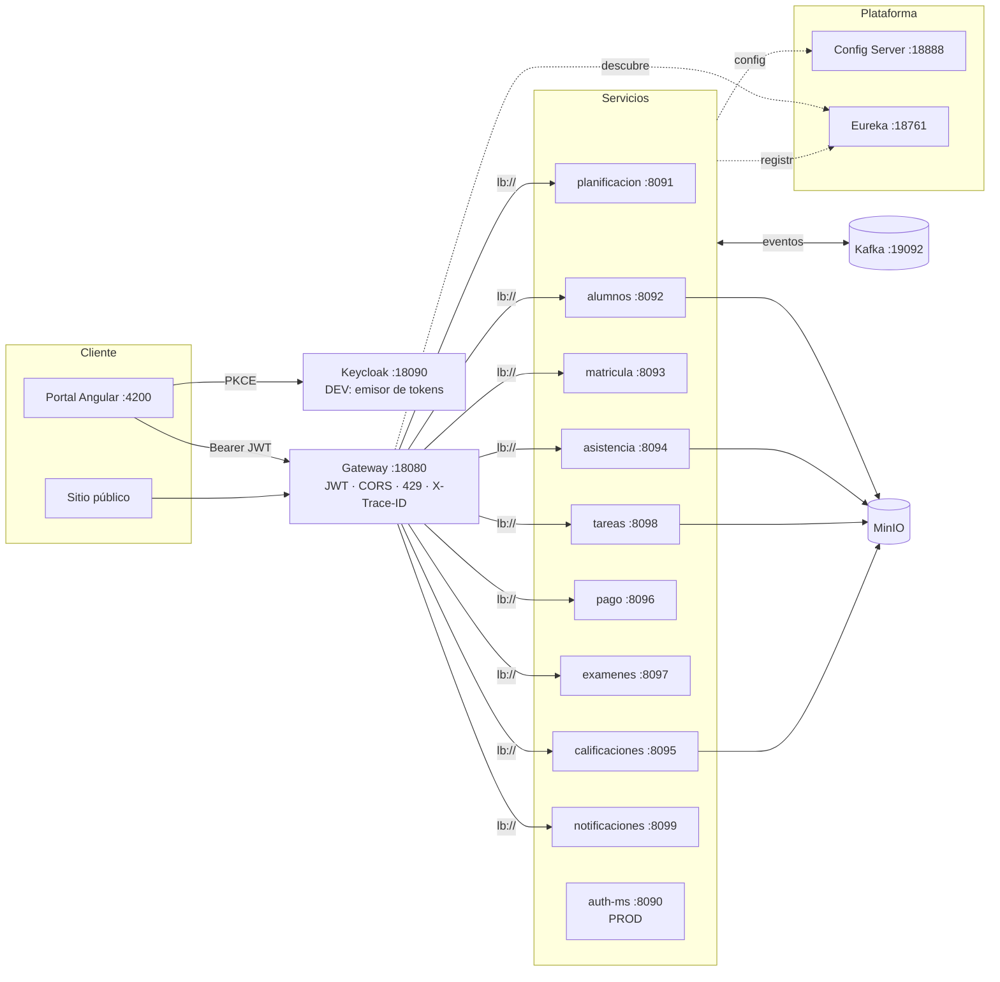
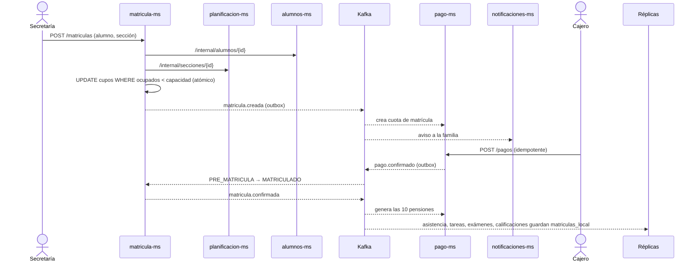
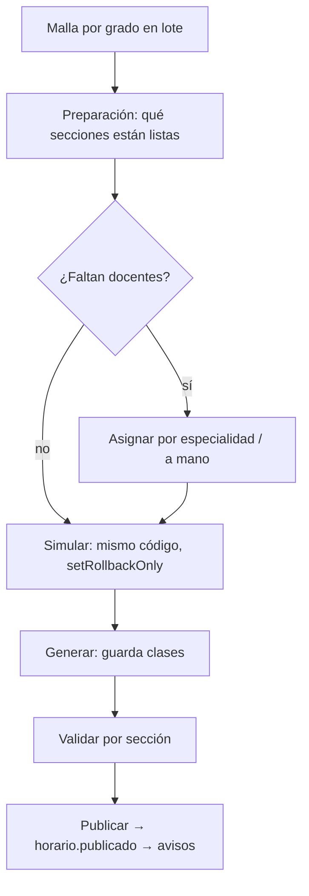

# Arquitectura

Basada en la arquitectura de referencia **Pagatu** (sesiones S1–S9 del curso): servicio base → configuración centralizada → registro y descubrimiento →
Gateway → comunicación síncrona resiliente → seguridad distribuida → mensajería asíncrona → consistencia distribuida.

## Vista general

- Cada servicio tiene **su propia base PostgreSQL** (puertos 15440–15449) con Flyway y `ddl-auto: validate`.
- **Síncrono (Feign)** solo hacia `/internal/**` con `X-Service-Token`; **asíncrono (Kafka)** para todo lo que otro servicio necesita saber.
- El Gateway no enruta `/internal/**`.

## Componentes de plataforma

| Componente | Rol | Detalle |
|---|---|---|
| **Config Server** | Configuración por ambiente | `infra/eduspace-config/config-repo/<servicio>-dev.yml` y `-prod.yml`; los servicios usan `optional:` y un `application.yml` mínimo |
| **Eureka** | Registro/descubrimiento | Los servicios se registran por nombre; el Gateway usa `lb://` (balanceo del lado cliente) |
| **Gateway** | Punto único | Valida JWT (JWKS), CORS, límite multipart, límite de peticiones por IP (API 300/min ráfaga 50; login 10/min ráfaga 5 → 429 con `Retry-After`), propaga `X-Trace-ID` |
| **Kafka** | Mensajería | 25 tópicos + DLT; mensajes JSON de texto, sobre plano |
| **MinIO** | Archivos | Documentos de alumnos, justificaciones, entregas de tareas y boletines; URLs firmadas |
| **Keycloak / auth-ms** | Identidad | Keycloak (PKCE) en DEV; `auth-ms` (RS256 + JWKS) en PROD |
| **Observabilidad** | Prometheus, Loki, Promtail, Grafana | Ver [Observabilidad](observabilidad.md) |

## Estructura interna de un servicio
`controller → service (interfaz + impl) → repository → entity`, con `dto/` y `mapper/`, `client/` (Feign), `messaging/` (productores/consumidores),
`scheduler/` (jobs con ShedLock), `config/` (seguridad, Kafka, caché) y `exception/` (`GlobalExceptionHandler`).

## Flujo 1 — matrícula y cobro (consistencia distribuida)

Si el pago se anula o la matrícula se retira, `pago.anulado` / `matricula.retirada` **compensan**: las cuotas pendientes se anulan y se libera el cupo.

## Flujo 2 — armado automático de horarios

Algoritmo (`horario/PlanificadorHorario`): espacio = día × bloque; restricciones **duras** de sección, docente y aula; orden por dificultad (MRV),
búsqueda local con lista tabú y semilla fija (2026) para resultados repetibles.

## Flujo 3 — asistencia y avisos
El docente abre la sesión del día (solo días hábiles, consulta feriados a planificación), registra a toda la sección y `asistencia.falta-registrada`
genera **una sola** notificación por falta; una justificación aprobada convierte las faltas del rango y publica `justificacion.resuelta`.

## Flujo 4 — matrícula en línea
El sitio público llama a `/api/v1/publico/matricula` (sin sesión, con límite propio por IP); `matricula-ms` orquesta alumnos, pago, cuentas y correo
con llamadas internas. Detalle y diagrama de secuencia: [Matrícula en línea](matricula-en-linea.md).

## Resiliencia
| Mecanismo | Dónde |
|---|---|
| Caché en consumidores de planificación/alumnos | asistencia, tareas, examenes, calificaciones, pago (docente→asignaciones, alumno, año) |
| Circuit breaker + fallback | notificaciones → alumnos (con fila marcadora y reintento al volver) |
| Outbox + relé | matricula, pago, alumnos, planificacion: el evento se guarda en la misma transacción y un job lo envía |
| Idempotencia | `eventos_procesados` en consumidores; `idempotency_key` + `version` en cobros |
| DLT y `ErrorHandlingDeserializer` | todos los consumidores (`<tópico>.DLT`) |
| ShedLock | un solo nodo ejecuta cada job programado |
| Zona horaria | `America/Lima` en todos |

## Decisiones técnicas clave
Ver [Decisiones de diseño](decisiones.md).
