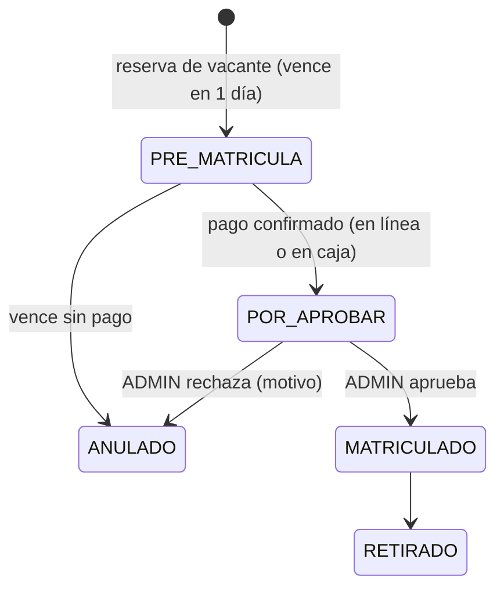
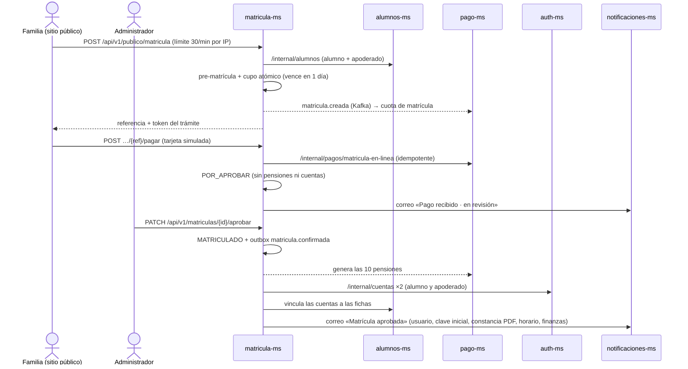

# Matrícula en línea (sitio público)

Desde la página pública del colegio (`/matricula-en-linea`) una familia puede **matricular a su hijo sin ir al colegio**: elige el grado, llena los datos,
reserva la vacante y paga la matrícula en la misma página. Después, **la administración la revisa y la aprueba**; recién entonces la familia recibe por correo su usuario y clave, la constancia y el horario. La pasarela de pago es de **demostración** (no cobra).

## Qué ve la familia (4 pasos)
| Paso | Qué ocurre |
|---|---|
| 1. Grado | Niveles y grados con **vacantes** y **costos** reales (matrícula y pensión) tomados del año activo; los grados sin vacantes o sin tarifa no se pueden elegir |
| 2. Datos | Alumno (documento, nombres, apellidos, fecha de nacimiento, sexo) y apoderado (documento, nombres, apellidos, teléfono, parentesco y **correo opcional**); validación en la página |
| 3. Pago | Resumen y costos; al aceptar el tratamiento de datos se **reserva la vacante** (pre-matrícula, vence en 1 día) y se abre la ventana de pago |
| 4. Revisión | «Pago recibido, tu matrícula está en revisión»: comprobante y qué sigue; botón *Consultar estado*. Al ser aprobada la misma página muestra usuario de alumno y apoderado, calendario de pensiones, horario y la constancia (PDF) |

Si la persona recarga la página a mitad del trámite, se **retoma** donde estaba (el trámite se guarda en la sesión del navegador).

## Pasarela de pago de demostración
Ventana con tarjeta (número, titular, vencimiento, CVV). No se cobra nada y **no se guarda ni se registra la tarjeta**: solo la marca y los últimos 4 dígitos.
- `4242 4242 4242 4242` + vencimiento futuro + cualquier CVV → **aprobado**.
- `4000 0000 0000 0002` → **rechazado** (para ver el caso de error).
- Se valida el número (Luhn), el vencimiento y el CVV.

## Ciclo de la matrícula: pago, aprobación y acceso

- **El pago ya no matricula**: deja la matrícula en `POR_APROBAR`. Conserva el cupo y no vence, pero **todavía no** se generan pensiones ni se publica `matricula.confirmada`.
- **Solo el ADMIN aprueba** (*Matrícula → Por aprobar*; secretaría recibe 403). Al aprobar: `MATRICULADO`, evento `matricula.confirmada` (pago-ms genera las 10 pensiones, asistencia y tareas ven al alumno) y, **si la matrícula fue en línea**, se crean las cuentas y se envía el correo de aprobación.
- **Rechazar** exige un motivo: se anula, se libera el cupo, se publica `matricula.anulada` y se avisa por correo a la familia. El pago se devuelve desde *Finanzas → Cobranza*.
- Si falla algo después de aprobar (cuenta o correo) **no se deshace la aprobación**: queda registrado y el admin puede usar `POST /api/v1/matriculas/{id}/reenviar-acceso`.

## Qué pasa al pagar y al aprobar (por dentro)

## Cuentas que se crean (al aprobar)
Usuario `nombre.apellido` (con número si ya existe) y clave inicial = documento, con cambio obligatorio al primer ingreso (misma regla que en
[Alumnos y entrada al sistema](alumnos-y-acceso.md)). Si el apoderado ya tenía cuenta (otro hijo ya matriculado), no se duplica.
Si algo falla al crear o vincular una cuenta, **el pago no se deshace**: la página avisa y secretaría completa el vínculo en *Avisos y cuentas → Cuentas de acceso*.

## Correos que recibe la familia
Solo si el apoderado dejó correo (si no, se omiten y se consulta el estado en la página):

1. **Al pagar** — «Pago recibido · matrícula en revisión»: monto, comprobante y que el acceso llegará cuando se apruebe (sin usuario ni clave todavía).
2. **Al aprobar** — «Matrícula aprobada»: ver abajo.
3. **Al rechazar** — «Matrícula no aprobada» con el motivo.

### Correo de aprobación (con los datos para iniciar sesión)
- Mensaje HTML con un recuadro **«Para iniciar sesión»** (portal, usuario del alumno, usuario del apoderado y clave inicial = documento, con cambio obligatorio) y además: matrícula (código, grado, sección, turno), **finanzas** (monto pagado, comprobante, calendario de pensiones y total, cómo pagar), **horario** y los documentos pendientes, **con la constancia en PDF adjunta**.
- Sin correo, el envío se omite y la constancia se descarga desde la página cuando el trámite está aprobado.
- Si el envío falla, queda registrado (`correo_estado = ERROR`) y el admin puede reenviarlo.
- La constancia (A4) lleva: datos de la matrícula, alumno, apoderado, pago, pensiones, horario semanal, usuarios de acceso y lo que se debe presentar en secretaría.

**¿Es un correo real?** El envío es real por SMTP: en DEV lo recibe **Mailpit** (`http://localhost:18025`); en PROD basta configurar el proveedor de correo
(`SMTP_HOST`, `SMTP_PORT`, `SMTP_USER`, `SMTP_PASSWORD`, `MAIL_FROM` en `notificaciones-ms`) y llegará a la bandeja de la familia.

## Seguridad
- Los endpoints `/api/v1/publico/**` no exigen sesión pero tienen su **propio límite de peticiones por IP** en el Gateway (30/min con ráfaga 15; 429 al pasarse).
- Validación estricta de entrada, **campo trampa** anti-robots y aceptación obligatoria del tratamiento de datos.
- Cada trámite tiene un **token** aleatorio (se guarda solo su hash SHA-256): quien lo inició es quien puede pagar, ver el resumen y bajar la constancia; sin él, 403.
- La pre-matrícula vence en **1 día** si no se paga y libera el cupo (`VencimientoJob`); una familia que vuelve con los mismos datos **retoma** su alumno en vez de crear otro.
- Con un documento ya registrado por otra vía, el sistema responde con un mensaje general y no revela datos de la persona.
- Las llamadas entre servicios usan `/internal/**` con el token de servicio; no pasan por el Gateway.
- El cliente web no adjunta el token de sesión a estas rutas (un token vencido de otra sesión no las bloquea).

## API (matricula-ms, vía Gateway)
| Endpoint | Uso |
|---|---|
| `GET /api/v1/publico/matricula/oferta` | Grados con vacantes y costos |
| `POST /api/v1/publico/matricula` | Inicia el trámite: registra, reserva y devuelve `referencia` y `token` |
| `POST /api/v1/publico/matricula/{ref}/pagar` | Paga con la tarjeta simulada y completa todo (cabecera `X-Matricula-Token`) |
| `GET /api/v1/publico/matricula/{ref}` | Resumen del trámite |
| `GET /api/v1/publico/matricula/{ref}/constancia` | PDF de la constancia |

Endpoints internos nuevos: `alumnos-ms` (`POST /internal/alumnos`, `POST /internal/alumnos|apoderados/{id}/usuario`), `auth-ms` (`POST /internal/cuentas`),
`pago-ms` (`GET /internal/tarifas/aplicable`, `GET /internal/pagos/matricula/{id}/cuotas`, `POST /internal/pagos/matricula-en-linea`),
`notificaciones-ms` (`POST /internal/correos`), `planificacion-ms` (`GET /internal/horarios/seccion/{id}`).

## Qué ve el personal
La matrícula pagada aparece en *Matrícula → Por aprobar* (solo ADMIN) con su origen, la fecha de pago y el estado del expediente; el estado **POR-APROBAR** también se ve en *Matrículas*. El expediente
(DNI, partida y ficha SIAGIE) se muestra como informativo: la administración decide si aprueba aunque falten documentos, que la familia presenta en secretaría. El pago aparece en *Finanzas → Cobranza* como «ONLINE/SIMULADO».

## Repetir la matrícula en línea (demostración y pruebas)
El documento del alumno es único: repetir el de una matrícula anterior da «ya hay un alumno registrado con ese documento». `python3 tools/demo/preparar_matricula_en_linea.py` limpia las matrículas de prueba (libera cupos y cuotas), comprueba la campaña y las vacantes, y entrega un alumno, un apoderado y un correo con documentos que nadie usó, listos para teclear. Con `--probar` hace además una matrícula completa de prueba (reserva y pago con `4242…`) y la rechaza para dejar el cupo libre.

## Límites conocidos
- La pasarela es simulada: para cobrar de verdad hay que integrar un proveedor (Culqi, Niubiz, etc.) en `pago-ms` (el punto de integración es `POST /internal/pagos/matricula-en-linea`).
- Al matricular a mitad de año, el sistema genera todas las pensiones del año (también las de meses pasados, que figuran vencidas): conviene definir una regla de prorrateo.
- No hay verificación de que el correo sea de quien lo escribe (la constancia solo contiene datos de la propia familia).
